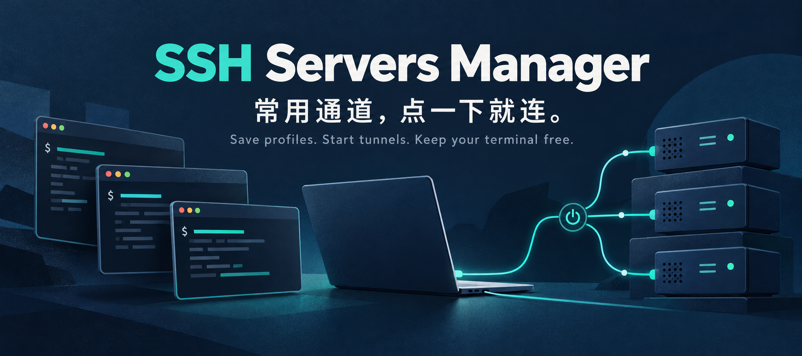
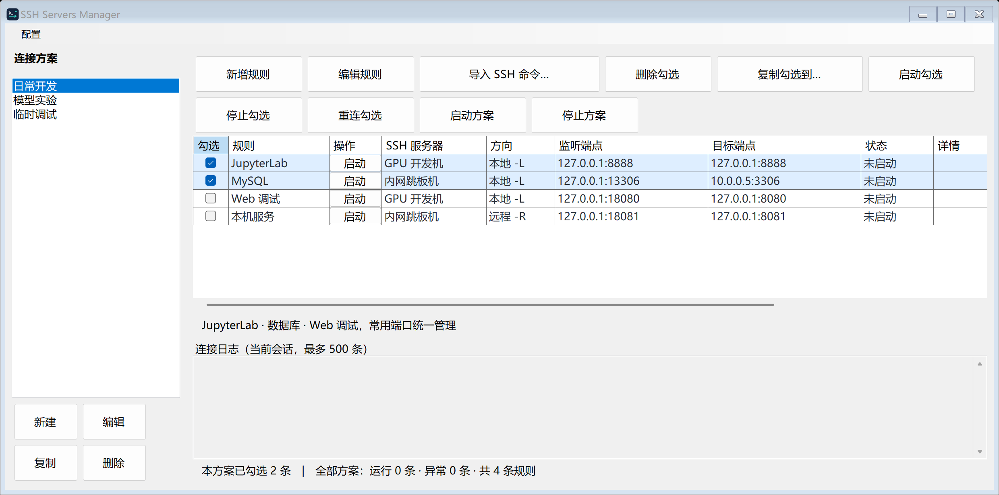
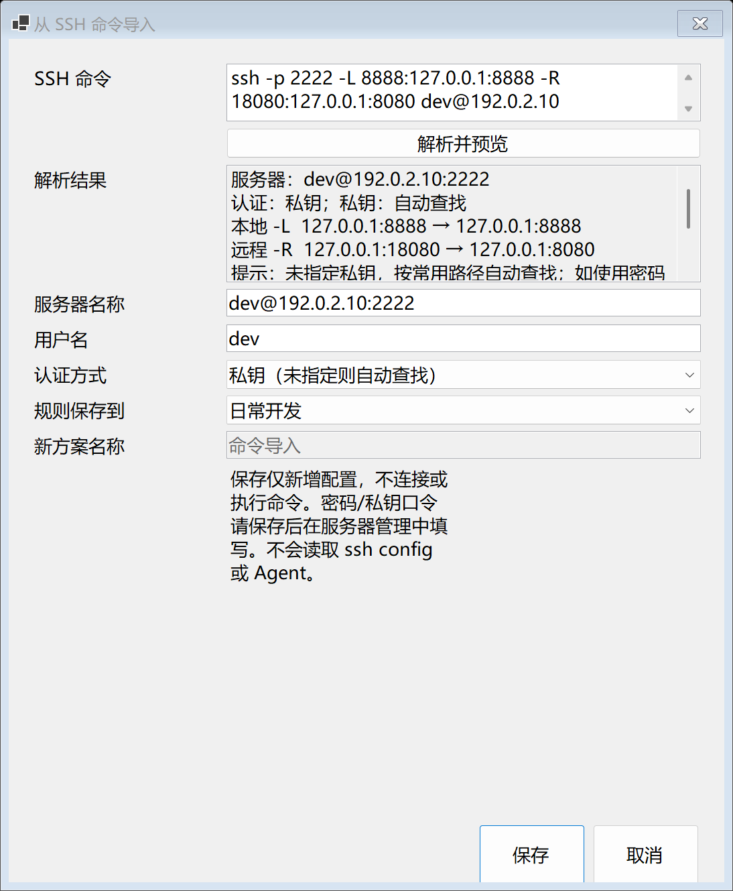
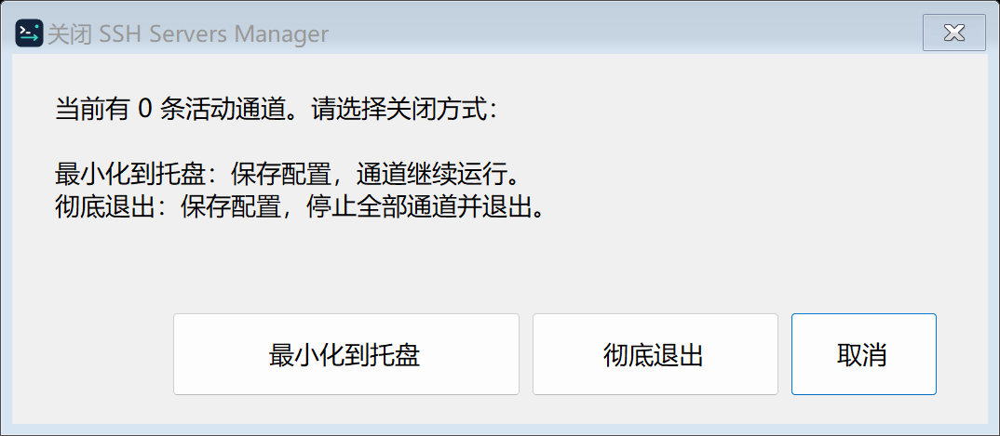

# SSH Servers Manager

**把每天重复输入的 SSH 命令，变成随手启停的连接方案。**

打开远程 JupyterLab，先翻记录找一遍 `ssh -L ...`；连接内网数据库，再复制一条命令；多开几个服务，终端窗口也越堆越多。临时换端口、换服务器，还得逐条改命令，记住哪个窗口维护着哪条通道。

SSH Servers Manager 把这些常用连接收进一个 Windows 桌面工具：**配置一次，保存成方案；要用时点启动，用完点停止。** 多台服务器、多个端口放在一起看，已有 SSH 命令也能直接粘贴导入，不用再为每条通道留一个终端窗口。

**[下载 Windows 安装包](https://github.com/zhu-0731/ssh-servers-manager/releases/download/v0.1.3/SSH-Servers-Manager-v0.1.3-win-x64-Setup.exe)** · [下载便携 ZIP](https://github.com/zhu-0731/ssh-servers-manager/releases/download/v0.1.3/SSH-Servers-Manager-v0.1.3-win-x64.zip) · [查看发行说明](https://github.com/zhu-0731/ssh-servers-manager/releases/tag/v0.1.3)

Windows x64 · 中文安装向导 · 内置 .NET 运行时 · 默认当前用户安装，无需管理员权限

## 这些时候，你可能会用得上

| 日常场景 | 交给软件管理 |
| --- | --- |
| 在浏览器里打开服务器上的 JupyterLab | 保存 `8888 → 8888`，下次直接启动本地转发 |
| 用本机数据库客户端连接远端内网 MySQL | 通过一台 SSH 服务器转发到内网数据库，端口和目标地址随方案保存 |
| 同时调试 Web、API 和其他 TCP 服务 | 每条规则独立启停，临时停一个端口不影响其他规则 |
| 让远端访问本机的调试服务 | 使用远程转发 `-R`，明确设置监听范围；服务端仍需允许转发 |
| 经常切换开发环境、实验服务器 | 建立多个方案，复制整个方案或把选中规则复制到新方案 |

## 常用连接，一眼看清

左侧选择方案，右侧查看服务器、转发方向、监听端口、目标地址和连接状态。可以单条启停，也可以勾选多条一起操作；批量操作只处理勾选项。

[](docs/images/dashboard.png)

*真实软件截图，使用隔离的示例配置，未连接服务器。点击图片可放大。*

## 已经有命令？粘贴进来就行

你不需要把现有连接重新手填一遍。点击“导入 SSH 命令”，粘贴常用命令，先核对预览，再保存到已有方案或新方案。

```bash
ssh -p 2222 -L 8888:127.0.0.1:8888 -R 18080:127.0.0.1:8080 dev@192.0.2.10
```

支持用户名、SSH 端口、私钥文件、多个 `-L/-R`、IPv6 及部分常用 `-o` 选项。**解析只生成配置，不执行命令，不自动连接。** 不支持的选项会明确提示。

<details>
<summary>查看真实的命令解析与导入窗口</summary>

<p></p>

截图中的地址与用户均为示例；保存前可修改名称、用户名和认证方式。

</details>

## 常用方案，复制着用

- **按环境保存**：把数据库、JupyterLab、Web 调试等规则放进“日常开发”方案。
- **相似配置直接复制**：复制整个方案，或只把几条端口规则复制到另一个方案，再改服务器和端口。
- **规则彼此独立**：停止或重连一条规则，不影响其他通道。
- **配置可迁移**：支持 JSON 导入导出，密码、私钥内容和口令不会进入导出文件。

服务器配置可以被不同规则复用；复制规则后，规则本身可以独立修改。

## 关掉窗口，也能继续工作

点击右上角叉号时，由你决定：保存配置并最小化到托盘，让通道继续运行；或停止全部通道、彻底退出。双击托盘图标可恢复窗口。

<p></p>

还提供连接日志、端口冲突提示、主机指纹确认和可选自动重连。密码与私钥口令存入 Windows 凭据管理器；私钥路径留空时，会自动查找常用 `.ssh` 路径中的密钥。

## 三步开始

1. **安装或解压**：[Setup 安装包](https://github.com/zhu-0731/ssh-servers-manager/releases/download/v0.1.3/SSH-Servers-Manager-v0.1.3-win-x64-Setup.exe)提供目录选择、可选桌面快捷方式和卸载入口；ZIP 解压后运行即可。两者均内置运行时。
2. **保存连接**：新增 SSH 服务器和转发规则，或直接导入现有 SSH 命令。配置需要的密码或私钥，首次连接核对服务器指纹。
3. **启动需要的端口**：单条启动或勾选批量启动；之后可以复用保存的方案。

详细操作与排错见 [使用说明](docs/user-guide.md)。已有旧实例时，请先从托盘彻底退出再升级；卸载会保留连接配置和凭据。

## 当前支持范围

当前是 Windows x64 公开预览版。已完成 32 项基础与真实 SSH 集成检查，并验证安装、快捷方式、安装后运行、重复安装和卸载流程。具体环境与覆盖范围见 [验证说明](docs/testing.md)。

- 支持本地 `-L` 和远程 `-R` TCP 转发、密码和文件私钥认证。
- 暂不支持 SSH Agent、完整 `ssh config`、多级跳板机、动态 SOCKS 和开机自动连接。
- 运行中的规则需要先停止再编辑。“运行中”表示 SSH 转发监听已建立，目标服务是否可用仍需实际验证。
- 程序与安装器尚未代码签名；不同 Windows、OpenSSH 策略、IPv6 网络和休眠唤醒还需要更多环境验证。

## 开发与文档

<details>
<summary>从源码运行、构建与打包</summary>

源码开发需要 .NET 8 SDK：

```powershell
dotnet run --project src/SshManager.App
powershell -ExecutionPolicy Bypass -File scripts/build.ps1 -Publish
powershell -ExecutionPolicy Bypass -File scripts/test.ps1
powershell -ExecutionPolicy Bypass -File scripts/package.ps1
powershell -ExecutionPolicy Bypass -File scripts/installer.ps1
```

`package.ps1` 从干净 Git 提交快照生成自包含 ZIP；`installer.ps1` 需要 Inno Setup，并校验 ZIP 后生成安装器。详见 [Setup 构建说明](installer/README.md)。

工作区可双击 `start.cmd`，优先启动本地构建。`build.ps1` 的普通构建需要 .NET 8 Desktop Runtime；GitHub ZIP 和 Setup 已内置运行时。源码在 `src/`，测试在 `tests/`，构建和打包脚本在 `scripts/`。构建输出、运行数据和发行包均不进入 Git。

</details>

| 文档 | 内容 |
| --- | --- |
| [使用说明](docs/user-guide.md) | 连接配置、命令导入、方案复制和故障排查 |
| [需求规格](docs/requirements.md) | 功能范围与验收标准 |
| [架构设计](docs/architecture.md) / [技术选型](docs/decisions/0001-windows-stack.md) | 模块、数据模型与实现依据 |
| [开发计划](docs/roadmap.md) / [变更记录](CHANGELOG.md) | 进展和版本变化 |
| [协作约定](CONTRIBUTING.md) / [验证说明](docs/testing.md) | 构建、测试与发布 |
| [配图来源](docs/images/README.md) | 真实截图说明与封面生成提示词 |

配置保存在 `%LOCALAPPDATA%\SshServersManager`，凭据保存在当前 Windows 用户的凭据管理器。仓库和发行包不包含个人配置、真实服务器信息、私钥或口令。

项目尚未指定开源许可证；公开仓库不代表已授予开源许可，第三方组件遵循各自许可证。
